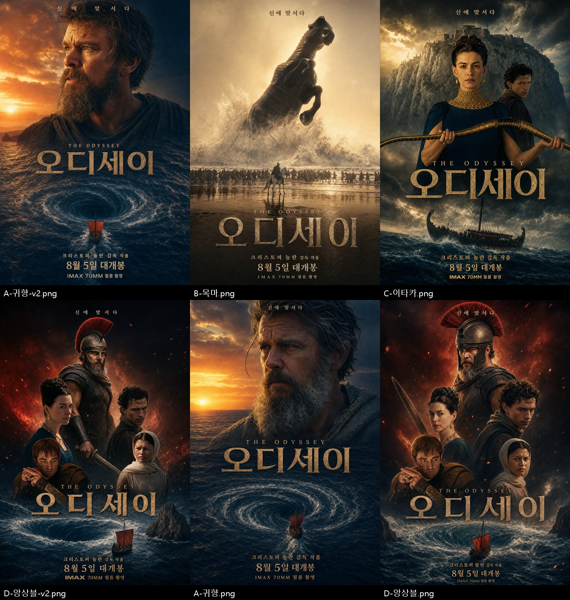

# 오디세이(2026) — GPT Image 2 로 만든 한국어 포스터

[odyssey-images/stills](../odyssey-images/stills/) 의 **장면 스틸만** 참고 이미지로 넣어
fal.ai `openai/gpt-image-2/edit` 로 만든 한국어 포스터다. 기존 포스터(`posters-*`, `key-art-wide`)와
포스터 아트를 잘라 둔 `stills/01~08-keyart-*` 는 넣지 않았다. 구도도 공식 포스터(투구 뒷모습 ·
불타는 목마 · 석상 머리)를 따라 하지 않는 새 구도로 잡았다.



| 파일 | 콘셉트 | 참고 스틸 |
|---|---|---|
| [A-귀향-v2.png](posters/A-귀향-v2.png) ★ | 수평선을 보는 오디세우스 얼굴 → 바다 → 소용돌이로 향하는 붉은 돛배 | 31 · 32 · 33 · 60 · 61 |
| [B-목마.png](posters/B-목마.png) ★ | 파도 속에서 솟는 거대한 청동 목마, 밧줄로 끄는 군대와 백마 탄 기수 | 14 · 15 · 18 · 19 · 21 |
| [C-이타카.png](posters/C-이타카.png) ★ | 활을 든 페넬로페와 텔레마코스, 절벽 위 이타카 요새, 폭풍 속 배 | 45 · 48 · 49 · 55 · 62 |
| [D-앙상블-v2.png](posters/D-앙상블-v2.png) ★ | 오디세우스 · 페넬로페 · 텔레마코스 · 안티노오스 · 흰 두건의 여인을 쌓은 구도 | 27 · 41 · 45 · 48 · 51 · 60 · 61 |
| [A-귀향.png](posters/A-귀향.png) | A 1차. 얼굴이 배우를 덜 닮아 v2 로 다시 뽑았다 | 31 · 35 · 58 · 60 · 61 |
| [D-앙상블.png](posters/D-앙상블.png) | D 1차. 칼이 손에 안 붙고 태그라인이 투구 깃털에 겹쳐 v2 로 다시 뽑았다 | v2 와 같음 |

문구는 [오디세이-영화소개.md](../오디세이-영화소개.md) 의 사실만 넣었다 — 「신에 맞서다」 ·
「크리스토퍼 놀란 감독 작품」 · 「8월 5일 대개봉」 · 「IMAX 70MM 필름 촬영」. 6장 모두 한글 철자를
원본 크기로 확인했다(오탈자 없음). 각 PNG 옆 `.json` 에 그 장의 프롬프트 · 참고 스틸 · request id 가 있다.

## 다시 만들기

```bash
# 레포 루트 .env 에 FAL_KEY=... 가 있어야 한다 (gitignore 됨)
python make_posters.py                 # A B C D 전부 (high · 1024x1536, 1장 약 100초)
python make_posters.py B --tag=-v3     # 하나만, 파일명에 꼬리표
python make_posters.py C --size 1536x2304
```

- 콘셉트별 장면 설명과 참고 스틸은 `make_posters.py` 의 `CONCEPTS` 에 있다. 공통 지시(한글 문구 · 금지 사항)는 `COMMON`.
- 참고 스틸은 1536px 로 줄여 base64 data URI 로 그대로 보낸다(업로드 단계 없음).
- 크기는 가로세로 16의 배수, 긴 변 3840 이하.
